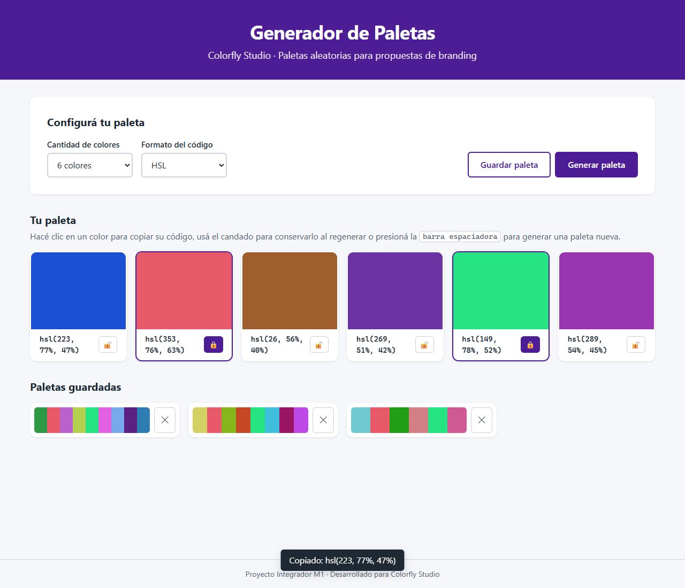

# 🎨 Generador de Paletas Interactivo · Colorfly Studio

> Proyecto Integrador M1 · **Pedro Alasino**

Aplicación web estática que genera paletas de colores aleatorias para acelerar las propuestas de branding de **Colorfly Studio**. Construida con HTML5 semántico, CSS3 y JavaScript vanilla, sin librerías ni frameworks y sin llamadas de red.

🔗 **Demo en vivo:** https://pedroalasino.github.io/ProyectoM1_PedroAlasino/
📦 **Repositorio:** https://github.com/pedroalasino/ProyectoM1_PedroAlasino



---

## 📋 Índice

1. [Funcionalidades](#-funcionalidades)
2. [Cómo usarla](#-cómo-usarla)
3. [Instalación y uso local](#-instalación-y-uso-local)
4. [Estructura del proyecto](#-estructura-del-proyecto)
5. [Decisiones técnicas](#-decisiones-técnicas)
6. [Accesibilidad](#-accesibilidad)
7. [Versionado y deploy](#-versionado-y-deploy)
8. [Uso de Inteligencia Artificial](#-uso-de-inteligencia-artificial)
9. [Evidencias](#-evidencias)

---

## ✅ Funcionalidades

### Alcance MVP (obligatorio)

| Requisito | Estado |
|---|---|
| Botón principal "Generar paleta" | ✅ |
| Selector de tamaño: 6, 8 o 9 colores | ✅ |
| Colores aleatorios en HSL y HEX/RGBA | ✅ Se generan en HSL y se convierten a HEX y RGBA |
| Código HEX visible en cada tarjeta | ✅ Además se puede elegir ver HSL o RGBA |
| Microfeedback visible (toast) | ✅ En cada acción, también anunciado a lectores de pantalla |
| HTML semántico y accesible | ✅ |
| Funciona en escritorio | ✅ y también en mobile |

### Extra credits

| Extra | Estado |
|---|---|
| Copiar el código al portapapeles al hacer clic en el color | ✅ |
| Bloqueo (lock) individual para conservar colores al regenerar | ✅ |
| Persistencia en `localStorage` | ✅ La paleta actual, los candados, el formato y hasta 12 paletas favoritas |
| Animaciones sutiles en la UI | ✅ Respetan `prefers-reduced-motion` |
| Atajo de teclado | ✅ Barra espaciadora para generar |

---

## 🖱️ Cómo usarla

1. Elegí la **cantidad de colores** (6, 8 o 9) y el **formato del código** (HEX, HSL o RGBA).
2. Presioná **Generar paleta**, o la **barra espaciadora**.
3. **Hacé clic en un color** para copiar su código.
4. Usá el **candado 🔓/🔒** para fijar los colores que te gustan; los demás cambian al regenerar.
5. **Guardar paleta** la agrega a "Paletas guardadas". Hacé clic en una guardada para volver a cargarla, o en ✕ para borrarla.

Todo queda guardado en el navegador: si cerrás la pestaña y volvés, encontrás la misma paleta.

---

## 💻 Instalación y uso local

No requiere instalación, dependencias ni servidor.

```bash
git clone https://github.com/pedroalasino/ProyectoM1_PedroAlasino.git
cd ProyectoM1_PedroAlasino
```

Después abrí `index.html` con doble clic. Para recarga automática al editar, podés usar la extensión **Live Server** de VS Code (clic derecho → *Open with Live Server*).

> El copiado al portapapeles necesita un contexto seguro (`https://`, `localhost` o `file://`). Funciona en GitHub Pages, en Live Server y abriendo el archivo directo.

---

## 📁 Estructura del proyecto

```
ProyectoM1_PedroAlasino/
├── index.html      # Estructura semántica (contenido)
├── style.css       # Estilos (presentación)
├── script.js       # Lógica e interacción (comportamiento)
├── README.md       # Esta documentación
├── docs/
│   └── prompts-ia.md   # Prompts completos usados con la IA
└── evidencias/     # Capturas del funcionamiento
```

Las tres capas (contenido, presentación y comportamiento) van en archivos separados. No hay estilos inline ni bloques `<style>` o `<script>` dentro del HTML.

---

## 🧠 Decisiones técnicas

### HTML5 semántico

- `<header>`, `<main>`, tres `<section>` (controles, paleta y guardadas) y `<footer>`. Se evita la "divitis": los únicos `<div>` agrupan un label con su select, los botones de acción y el toast, donde no hay una etiqueta semántica que corresponda.
- **Un solo `<h1>`** y jerarquía de títulos sin saltos (`h1 → h2`).
- La paleta es una **lista** (`<ul>` / `<li>`), porque eso es: un conjunto de colores. Los códigos se muestran en `<code>` y el atajo de teclado en `<kbd>`.
- `<!DOCTYPE html>`, `lang="es"` y `<meta charset="UTF-8">` como primera etiqueta del `<head>`, para evitar caracteres rotos (mojibake).
- El script se carga en el `<head>` con **`defer`**: se descarga en paralelo y se ejecuta con el DOM ya construido.

### CSS3

- **Variables en `:root`** para colores de marca, grises, color de estado, fuentes, espaciados, radios, sombras y transiciones. Cambiar la identidad visual es editar un solo bloque.
- **Reset global** con `box-sizing: border-box`: el ancho declarado incluye padding y borde, así los tamaños son predecibles.
- **Flexbox** para distribuir en una dirección: el `body` en columna (footer siempre abajo), la barra de controles con `flex-wrap` y el interior de cada tarjeta.
- **CSS Grid** para la paleta, con `repeat(auto-fill, minmax(10rem, 1fr))`: entran tantas columnas como quepan y se reparte el espacio sobrante. Así 6, 8 o 9 colores se acomodan solos, y en mobile pasa a 2 columnas sin media queries.
- **Clases BEM en kebab-case** que describen propósito y no apariencia (`.color-card__swatch`, `.btn--primary`). Los estados son modificadores (`.color-card--locked`, `.toast--visible`) que JavaScript agrega o quita con `classList`.
- **Unidades relativas:** `rem` para tipografía y espaciado global, `em` para el padding interno de botones y selects, `fr` y `%` para el layout.
- **Fuentes del sistema** (`system-ui`): sin Google Fonts, para cumplir la regla de cero llamadas de red.

### JavaScript vanilla

- **`const` por defecto, `let` solo para lo que se reasigna** (`palette`, `savedPalettes`, `toastTimeoutId`). Sin `var`.
- **Igualdad estricta (`===` / `!==`)** en todo el código.
- **Aleatoriedad:** `Math.floor(Math.random() * (max - min + 1)) + min` devuelve un entero en el rango `[min, max]`.
- **El color se genera en HSL.** Tono de 0 a 359°, saturación de 45 a 90% y luminosidad de 30 a 75%. Acotar saturación y luminosidad evita grises apagados y colores casi blancos o negros, que no sirven para branding. HEX y RGBA se calculan desde HSL con la fórmula de la especificación CSS Color 4.
- **Un array como fuente de verdad:** `palette` guarda `{ h, s, l, locked }` y el DOM siempre se dibuja a partir de él. Nunca se lee el color desde el HTML.
- **DOM seguro:** las tarjetas se crean con `createElement` y el texto se asigna con `textContent`, nunca con `innerHTML`, así ningún texto se interpreta como HTML (protección XSS). El único estilo que asigna JS es `backgroundColor`, porque el color es dinámico y no puede vivir en el CSS.
- **Delegación de eventos:** un solo `addEventListener` en la grilla atiende los clics de todas las tarjetas, incluso las creadas después. `event.target.closest('[data-action]')` identifica el botón y `data-action` / `data-index` dicen qué hacer y sobre qué color.
- **Bloqueo:** al regenerar, cada posición conserva su color si está bloqueado. La misma lógica resuelve el cambio de tamaño. Al bloquear se actualiza solo esa tarjeta, para no perder el foco del teclado ni repetir animaciones.
- **Portapapeles:** `navigator.clipboard.writeText()` devuelve una Promesa. Con `async/await` y `try/catch` el toast confirma el copiado o avisa si falló.
- **`localStorage`:** guarda texto, así que se usa `JSON.stringify` / `JSON.parse`. Toda lectura está en `try/catch` y se valida antes de usarse: si el dato está corrupto o el navegador bloquea el almacenamiento (modo privado), la app genera una paleta nueva en vez de romperse.

---

## ♿ Accesibilidad

- Cada `<select>` tiene su **`<label for="...">`** asociado.
- **Foco visible** con `:focus-visible`: contorno ámbar de 3px al navegar con teclado (WCAG 2.4.7).
- **Todo es operable con teclado.** Las muestras de color y los candados son `<button>` reales, que se activan con Enter o Espacio.
- **`aria-label` descriptivos:** "Copiar color #1EB869", "Bloquear color 3", "Cargar paleta guardada: #...".
- **`aria-pressed`** en el candado, para que el lector de pantalla anuncie si está activado.
- El **toast** usa `role="status"` + `aria-live="polite"`: los mensajes se anuncian sin interrumpir.
- `aria-labelledby` convierte cada sección en una región con nombre.
- **Contraste WCAG AA verificado:**

| Combinación | Contraste | Mínimo |
|---|---|---|
| Texto principal `#1F2933` sobre `#F5F7FA` | ~14:1 | 4.5:1 |
| Texto secundario `#52606D` sobre `#F5F7FA` | ~6:1 | 4.5:1 |
| Blanco sobre violeta `#4C1D95` (header y botón) | ~10:1 | 4.5:1 |
| Rojo `#B91C1C` (eliminar) sobre blanco | ~6.4:1 | 4.5:1 |

- `prefers-reduced-motion` desactiva las animaciones si el usuario lo pidió en su sistema operativo.

---

## 🌿 Versionado y deploy

### Commits

Cada commit es atómico (una funcionalidad por commit) y usa mensajes semánticos en imperativo:

```
feat: agrega estructura HTML semántica y archivos base
style: agrega variables CSS, reset de box model y grilla de la paleta
feat: agrega generación de colores HSL y conversión a HEX y RGBA
feat: renderiza tarjetas de color y agrega toast de microfeedback
feat: agrega copiado al portapapeles y bloqueo individual de colores
feat: persiste la paleta y agrega paletas guardadas en localStorage
fix: evita que los códigos HSL y RGBA se corten en medio de un número
docs: agrega README, registro de uso de IA y evidencias
```

### Deploy en GitHub Pages

1. Crear en GitHub un repositorio **público** y vacío llamado `ProyectoM1_PedroAlasino`.
2. Conectar y subir:
   ```bash
   git remote add origin https://github.com/pedroalasino/ProyectoM1_PedroAlasino.git
   git push -u origin main
   ```
3. En GitHub: **Settings → Pages → Source: Deploy from a branch → Branch: `main` / `(root)` → Save**.
4. Esperar uno o dos minutos y abrir `https://pedroalasino.github.io/ProyectoM1_PedroAlasino/`.

Todas las rutas son **relativas** (`style.css`, `script.js`) y los nombres de archivo están en minúsculas. Esto importa porque GitHub Pages distingue mayúsculas de minúsculas, aunque Windows no.

---

## 🤖 Uso de Inteligencia Artificial

Usé **Claude (Claude Code, en VS Code)** como asistente de desarrollo. Los prompts completos están en [docs/prompts-ia.md](docs/prompts-ia.md).

### Prompt principal (Plantilla de Prompt Experto)

| Componente | Contenido |
|---|---|
| **Contexto** | Desarrollador/a Frontend Junior contratado por Colorfly Studio para un MVP de generador de paletas. |
| **Objetivo** | Diseñar, implementar y documentar la app cumpliendo el MVP, la accesibilidad y la entrega. |
| **Instrucciones** | HTML semántico, CSS con variables y Flexbox/Grid, JS con `const`/`let` y `===`, `Math.random` + `Math.floor`, `addEventListener`, toast y extras. |
| **Restricciones** | Solo JavaScript vanilla, sin frameworks ni librerías, sin `fetch`; app 100% estática. |
| **Formato de salida** | Guía paso a paso, explicando cada decisión técnica y pidiendo confirmación antes de avanzar. |

### Iteraciones

| # | Lo que pedí | Lo que pasó |
|---|---|---|
| 1 | Master prompt: empezar por el Paso 1 (estructura y HTML) | La IA creó la estructura de archivos e `index.html`, explicó cada etiqueta y pidió confirmación. Agregó un selector de formato HEX/HSL/RGBA. |
| 2 | "Pedro Alasino, hacé como está explicado en clase" | Inicializó Git en `main`, hizo el primer commit y desarrolló el Paso 2 (CSS) explicando variables, box model, Flexbox vs Grid y unidades. |
| 3 | "Terminalo completo" | Completó el JS en commits atómicos (colores, render + toast, copiar + lock, `localStorage`), lo probó en un navegador automatizado y generó las capturas. |
| 4 | *(Detectado en la revisión)* | En las capturas los códigos HSL se cortaban en medio de un número (`hsl(324, 4` / `5%`). Se corrigió cambiando `word-break: break-all` por `overflow-wrap: break-word` en un commit `fix:` aparte. |

### Aprendizajes

- **Un prompt estructurado da mejores resultados.** Separar contexto, objetivo, instrucciones, restricciones y formato evitó respuestas genéricas: la IA respetó "sin frameworks" y "sin `fetch`" sin que tuviera que repetirlo.
- **Ir paso a paso me ayudó a entender.** Ver el *por qué* de cada decisión (por ejemplo, `defer` o `auto-fill` + `minmax`) fue más útil que recibir todo el código de una vez.
- **Hay que verificar lo que genera la IA.** El código "funcionaba", pero recién al mirar las capturas apareció el problema de los códigos cortados. Probar en el navegador sigue siendo responsabilidad de quien desarrolla.
- **Pedir pruebas concretas.** La verificación automática (bloquear, regenerar, guardar, recargar) confirmó que la persistencia y los candados funcionan. También mostró que el portapapeles necesita un clic real del usuario: los navegadores lo exigen por seguridad.
- **La IA no reemplaza entender el código.** Puedo explicar cada función de `script.js` porque la revisé y la discutí paso a paso.

---

## 📸 Evidencias

| Captura | Muestra |
|---|---|
| [01-vista-inicial.png](evidencias/01-vista-inicial.png) | Estado inicial con 6 colores en HEX |
| [02-colores-bloqueados.png](evidencias/02-colores-bloqueados.png) | Dos colores bloqueados que se conservaron al regenerar |
| [03-formato-hsl-y-paletas-guardadas.png](evidencias/03-formato-hsl-y-paletas-guardadas.png) | Formato HSL, toast "Copiado" y paletas guardadas de 6, 8 y 9 colores |
| [04-foco-visible-teclado.png](evidencias/04-foco-visible-teclado.png) | Foco visible al navegar con Tab |
| [05-vista-mobile.png](evidencias/05-vista-mobile.png) | Diseño responsivo a 390px de ancho |

---

Proyecto Integrador M1 · Hecho por **Pedro Alasino** para Colorfly Studio.
