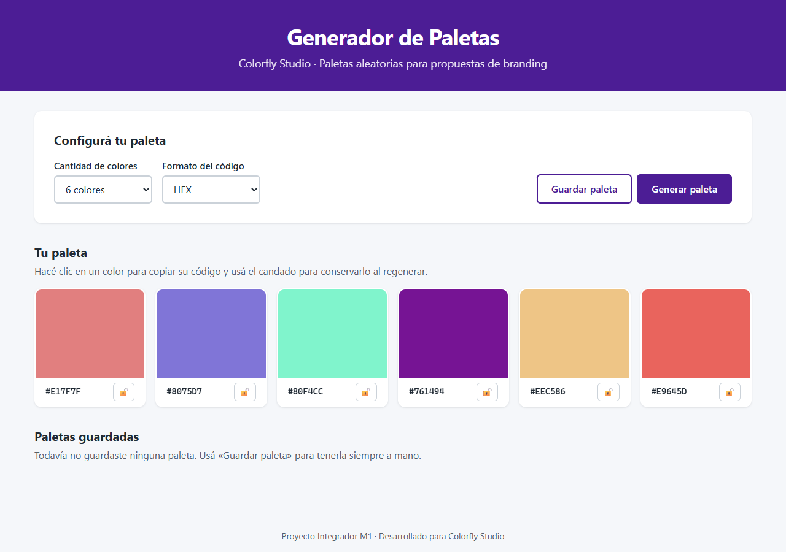
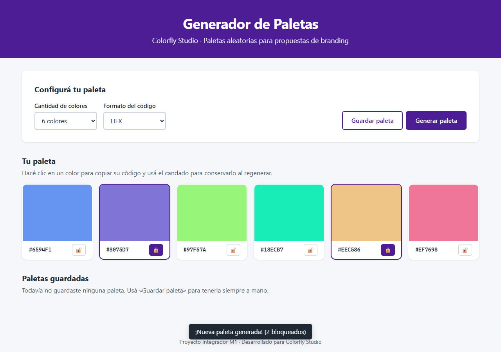
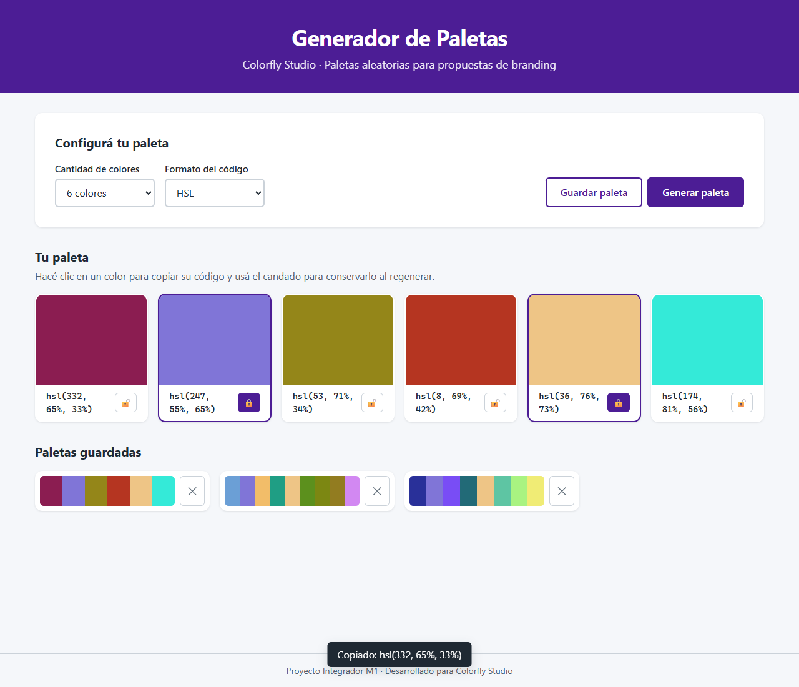

# Registro de prompts · Uso de IA

Registro completo de los prompts usados para desarrollar el proyecto con **Claude (Claude Code en VS Code)**, siguiendo la *Plantilla de Prompt Experto* vista en clase.

---

## Prompt 1 · Master Prompt

Preparé el prompt en dos versiones. La primera era una versión resumida de la consigna. La segunda (la que usé) la mejoré para incluir todas las normas técnicas explicadas en clase.

```text
PROMPT MASTER EXPERTO: DESARROLLO GUIADO PASO A PASO DEL PROYECTO INTEGRADOR M1 (COLORFLY STUDIO)

[CONTEXTO]
Actúas como un Desarrollador/a Frontend Junior encargado por Colorfly Studio (agencia de branding)
para construir un MVP funcional de una aplicación web estática e interactiva que genera paletas de
colores aleatorias para acelerar propuestas creativas. Se deben aplicar rigurosamente todas las
explicaciones de clase sobre HTML5 semántico, CSS3 moderno (Box Model, Flexbox/Grid, variables CSS),
JavaScript Vanilla (manipulación del DOM, eventos, objeto Math), accesibilidad web (WCAG), versionado
profesional con Git/GitHub y despliegue en GitHub Pages.

[OBJETIVO]
Diseñar, implementar y documentar la aplicación web "Generador de Paletas Interactivo", garantizando
el cumplimiento del alcance funcional mínimo obligatorio (MVP), las consideraciones de accesibilidad,
las buenas prácticas de maquetado/código, los puntos extra (extra credits) y la estructura de
entregable requerida.

[REQUISITOS Y NORMAS TÉCNICAS EXPLICADAS EN CLASE]

1. ESTRUCTURA HTML5 SEMÁNTICA Y ACCESIBILIDAD:
   - Etiquetas semánticas (<header>, <main>, <section>, <article>, <nav>, <footer>), evitando la "divitis".
   - <!DOCTYPE html>, lang="es" y <meta charset="UTF-8"> para evitar mojibake.
   - Un solo <h1> y jerarquía lineal de títulos (h1 -> h2 -> h3).
   - Botón principal "Generar paleta" y <select> de tamaño (6, 8 o 9) con <label for>.
   - Contraste WCAG (4.5:1 texto normal, 3:1 grande), foco visible, alt/aria-labels.
   - Etiquetas cerradas, minúsculas y atributos entre comillas.

2. ESTILOS VISUALES Y MAQUETADO CSS3:
   - Solo hoja externa style.css vía <link>. Prohibidos estilos inline y bloques <style>.
   - Reset: *, *::before, *::after { box-sizing: border-box; margin: 0; padding: 0; }
   - Variables CSS en :root (colores, grises, sombras, fuentes, espaciados).
   - Flexbox (justify-content, align-items, gap, flex-wrap) o Grid (repeat, minmax, fr).
   - Clases por propósito en kebab-case / BEM (.bloque__elemento--modificador).
   - Unidades relativas: rem (fuentes/espaciado), em (padding de componentes), % o fr (layouts).

3. LÓGICA Y MANIPULACIÓN DEL DOM (JavaScript Vanilla):
   - script.js externo con 'defer'.
   - const y let; PROHIBIDO var. Igualdad estricta (===).
   - Math.random() + Math.floor() para generar colores en HSL y HEX/RGBA.
   - getElementById / querySelector, addEventListener ('click', 'change') usando event.target,
     textContent para el contenido y classList.add/remove/toggle para los estilos.
   - Microfeedback visible (toast, tooltip o mensaje temporal).
   - Extras: copiar HEX al portapapeles, bloqueo (lock) individual, localStorage, animaciones CSS.

4. VERSIONADO (Git & GitHub):
   - git init con rama main; commits atómicos con mensajes semánticos imperativos.
   - Repositorio remoto ProyectoM1_NombreEstudiante; git push -u origin main.

5. DESPLIEGUE EN GITHUB PAGES:
   - Settings > Pages, rama main, carpeta / (root).
   - Sin rutas absolutas locales ni diferencias de mayúsculas/minúsculas.

6. DOCUMENTACIÓN:
   - README.md con título, descripción, decisiones técnicas, instalación y link a la demo.
   - Uso de IA según la Plantilla de Prompt Experto (Contexto, Objetivo, Instrucciones,
     Restricciones, Formato, Ejemplos, Iteraciones y Aprendizajes) con capturas.

[RESTRICCIONES TÉCNICAS ABSOLUTAS]
- Solo JavaScript Vanilla. Prohibidos frameworks y librerías (Bootstrap, Tailwind, React, jQuery, Axios...).
- Prohibidas las llamadas de red (fetch/axios): la app debe ser 100% estática.

[FORMATO Y METODOLOGÍA DE SALIDA]
Actúa como un tutor/asistente técnico senior. No entregues todo el código en un solo bloque.
Guíame paso a paso (módulo por módulo), explicando las decisiones técnicas según lo enseñado en
clase y pidiendo mi confirmación antes de avanzar al siguiente módulo.
```

**Resultado:** la IA armó la estructura de archivos (`index.html`, `style.css`, `script.js`, `evidencias/`) y el HTML semántico. Explicó cada decisión y pidió confirmación.



---

## Prompt 2 · Confirmación del Paso 1

```text
Pedro Alasino, hacé como está explicado en clase
```

**Resultado:** inicializó el repositorio Git en la rama `main` e hizo el primer commit (`feat: agrega estructura HTML semántica y archivos base`). Después desarrolló el Paso 2 (CSS): variables en `:root`, reset de box model, Flexbox para los controles, Grid para la paleta, foco visible y contraste WCAG.

---

## Prompt 3 · Completar el proyecto

```text
Vos terminalo, hacelo completo
```

**Resultado:** la IA completó el JavaScript (generación de colores, tarjetas y toast) y agregó funcionalidades extra (bloqueo, copiar al portapapeles y paletas guardadas en `localStorage`). Lo probó en el navegador y generó las capturas.



---

## Prompt 4 · Ajustar al alcance pedido

```text
El README: quitar los emoticones y las tablas, hacerlo corto y no poner funcionalidades extras.
Y quitar las funcionalidades extras no requeridas.
```

**Resultado:** se simplificó el README y se sacaron de la app el bloqueo, el copiado, las paletas guardadas, el selector de formato y el atajo de teclado. La app quedó con el alcance del MVP: botón "Generar paleta", selector de 6, 8 o 9 colores, códigos HEX y HSL visibles y toast.

---

## Prompt 5 · Volver a agregar los extras

```text
(Le pasé la consigna completa con la lista de extra credit)
Agregalas si las pide.
```

**Resultado:** como la consigna lista los extras como puntos adicionales, se volvieron a agregar: bloqueo de colores, copiar el código HEX al hacer clic, paletas guardadas en `localStorage`, animaciones sutiles y mejoras visuales. Se dejó afuera el atajo de teclado, porque la consigna no lo pide. Se probó todo en el navegador: el bloqueo conserva los colores, el portapapeles recibe el HEX y las paletas siguen ahí al recargar la página.



---

## Prompt 6 · Ajustar a la rúbrica

```text
(Le pasé el entregable final y la rúbrica de corrección)
```

**Resultado:** la rúbrica pide, para "Excelente", que la lógica "permita alternar entre formatos y genere colores válidos en ambos". Se agregó un selector para alternar entre HEX y HSL, y se verificó que los dos códigos representen el mismo color. La documentación se ordenó en la carpeta `documentacion/` (capturas de la app, capturas de la IA y este registro), y el README se completó con instrucciones de uso y pasos para ejecutar y desplegar.

---

## Capturas de la conversación con la IA

Las capturas del chat con la IA están en la carpeta [capturas-ia/](capturas-ia/).

---

## Aprendizajes sobre el uso de la IA

1. **La estructura del prompt importa.** Las restricciones explícitas ("sin frameworks", "sin fetch") se respetaron sin tener que repetirlas.
2. **Pedir explicaciones y no solo código** convirtió a la IA en un tutor. Cada paso vino con el *por qué*, conectado con lo visto en clase.
3. **Siempre hay que verificar.** El código compilaba y "funcionaba", pero hubo un detalle visual que solo se vio al mirar el resultado en el navegador.
4. **Hay que controlar el alcance.** La IA tiende a agregar más de lo pedido; conviene revisar que el resultado se ajuste a la consigna.
